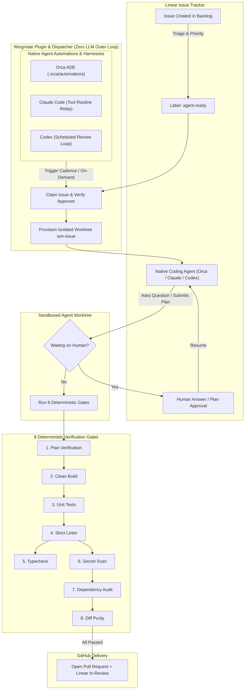

<div align="center">

# 🪽 Wingmate Agents

### **Universal Coding Agent Automation & Safety Plugin**
#### *Orchestrating Orca Automations · Claude Code Routines · OpenAI Codex Scheduled Tasks*

[](https://linear.app)
[](#2-orca-ade-automation-plugin)
[](#3-claude-code--codex-integration)
[](#3-claude-code--codex-integration)
[](https://bun.sh)
[](https://www.typescriptlang.org)
[](#the-8-deterministic-safety-gates)
[_%7C_Dark_%7C_System-64748B?style=for-the-badge)](#-architect-command-center-ui)

<p align="center">
  <b>Supercharge your existing coding agents with autonomous Linear-to-GitHub orchestration.</b><br>
  Wingmate operates as an orchestration and safety plugin that harnesses your native coding assistants (Orca, Claude Code, Codex) to interact with Linear issues, Git worktrees, and GitHub PRs—<b>without creating a redundant competing chatbot harness</b>.
</p>

---

### **Pipeline Lifecycle Stages**

| Stage | Badge | Meaning |
| :--- | :--- | :--- |
| **1. Todo** |  | Unassigned candidate issues in Linear awaiting architect prioritization |
| **2. Agent-Ready** |  | Labeled and queued for autonomous pickup by the dispatcher |
| **3. In Worktree** |  | Native agent actively implementing code in an isolated sandboxed Git worktree |
| **4. Waiting on You** |  | Paused for human plan review, clarification question, or architecture approval |
| **5. In Review / PR** |  | All 8 gates passed, verified pull request opened on GitHub |
| **6. Done / Merged** |  | PR merged, Linear issue closed, worktree safely reclaimed |

</div>

---

## ⚡ Why Wingmate as a Plugin?

Coding agents like **Orca ADE**, **Claude Code**, and **OpenAI Codex** are already exceptional at conversational code reasoning, editing, and tool execution. Developers do not need another chat window.

What developers and architects actually need is the **deterministic outer loop**:
- **🔌 Native Harness Interoperability**: Wingmate uses your existing automations (`.orca/automations`, Claude Code tool routines, Codex scheduled tasks) to drive agents via the native chatbot harness rather than creating a new harness.
- **🔒 Credential-Free Agent Sandboxes**: Agents never hold Git credentials, API keys, or direct push rights. All writes and comments occur via the official Wingmate Linear OAuth app.
- **🛡️ 8 Deterministic Safety Gates**: No PR is ever opened without passing automated plan verification, unit tests, strict typechecking, linter checks, secret scanning, and dependency audits.
- **🙋 Human-in-the-Loop Approval**: When agents formulate an implementation plan or hit ambiguous requirements, execution safely parks and notifies you with 1-click plan approval.
- **🖥️ Architect Command Center UI**: Zero-dependency, lightweight web dashboard featuring both a 6-stage Kanban board and Funnel pipeline view, **Light theme by default (matching Orca ADE)**, **Dark**, and **System** themes.

---

## 🏗️ Architecture



---

## 📦 How to Ship & Distribute Wingmate

Wingmate is designed for zero-friction distribution across different engineering workflows:

### 1. Standalone Single Binary (Recommended)
Built via Bun's native self-contained compilation (`bun build --compile`). Produces a single executable containing the CLI, the server, and the dashboard with **zero external runtime dependencies**:
```sh
# Build binary
bun run build

# Binary output: dist/wingmate (~60MB self-contained executable)
./dist/wingmate --version
```
- **GitHub Releases**: Pre-compiled binaries for `darwin-arm64` (Apple Silicon), `darwin-x64` (Intel Mac), and `linux-x64`.
- **One-Line Curl Installer**:
  ```sh
  curl -fsSL https://raw.githubusercontent.com/furoyce/wingmate-agents/main/install.sh | bash
  ```
- **Homebrew Tap**:
  ```sh
  brew install furoyce/tap/wingmate
  ```

### 2. Orca ADE Automation Plugin
Wingmate integrates natively into Orca ADE as a first-class automation plugin:
- **Native Automation Cadence**: Configures scheduled runs via `.orca/automations` executing `wingmate tick --precheck` every 5 minutes.
- **Orca Light Theme Match**: The Architect Command Center defaults to a clean, crisp light theme designed to seamlessly match Orca ADE's default UI aesthetic.
- **Integrated Webview**: Run as an embedded Webview tab (`http://127.0.0.1:4848`) alongside active chat sessions.
- **One-Click Worktree Jump**: Clicking **"Worktree ↗"** directly opens the agent's active worktree session in your editor.

### 3. Claude Code & Codex Integration
Use Wingmate to orchestrate Claude Code and OpenAI Codex without wrapping them in an unnecessary chatbot layer:
- **Claude Code**: Relay continuous tool routines directly inside isolated Git worktrees (`wm-<issue>`). The native agent handles code reasoning while Wingmate validates gates and surfaces plan approvals.
- **OpenAI Codex**: Trigger scheduled tasks and non-blocking PR review loops.
- **Native Tooling**: Provide `wingmate status --json` and `wingmate scan` directly to your agent's terminal tools.

### 4. Background System Daemon
Run the dispatcher and UI server as a background service:
- **macOS (`launchd`)**: Runs automatically at user login.
- **Linux (`systemd`)**: System service for headless CI/CD runner nodes.

---

## 🚀 Quick Start (5 Minutes)

### Step 1: Install Wingmate
```sh
# Clone repository
git clone https://github.com/furoyce/wingmate-agents.git
cd wingmate-agents

# Install dependencies and build
bun install
bun run build
```

### Step 2: Configure Linear & Projects
Create `config/projects.yaml` defining your workspace, projects, and repositories:
```yaml
workspace:
  team: JRF
  approvers: [your-linear-user-id]
labels:
  agent: { supported: [agent-ready, claude, codex] }
projects:
  my-app:
    linearProject: <linear-project-id>
    repos:
      main:
        github: org/my-app
        base: origin/main
        setup: [npm, ci]
        gates: [[npm, test], [npm, run, check]]
```

### Step 3: Run Diagnostics & Enable
```sh
# Verify connectivity, OAuth, and sandboxes
wingmate doctor

# Install worktree and enable the automation
wingmate install --enable
```

### Step 4: Launch the Architect Command Center
```sh
# Launch the dashboard and open in browser
wingmate ui --open

# Or run the background UI daemon
wingmate ui --serve &
```
Open **[http://127.0.0.1:4848](http://127.0.0.1:4848)** to monitor active worktrees, view metrics, and review agent plans.

---

## 🎨 Architect Command Center UI

The built-in Command Center gives engineering architects complete visibility into the autonomous agent fleet:

_%7C_Dark_%7C_System-38BDF8?style=flat-square)


- **☀️ Light Theme by Default (Orca-Matched)**: Crisp, high-contrast light theme calibrated to match Orca's default interface color palette.
- **🌙 Dark & 💻 System Modes**: Obsidian slate dark theme and dynamic system theme mode that automatically respects your OS appearance preference.
- **☷ 6-Column Responsive Kanban Board**: Fluid, full-width responsive layout adapting dynamically to any screen width (ultra-wide monitors, laptops, and split panes) with **zero horizontal sliders**.
- **↗ Answer in Linear**: Open the issue and reply to Wingmate's existing question as your signed-in owner account. Console answer submission is unavailable; the dispatcher verifies and delivers eligible replies on its next tick.
- **📊 Native Automations & Routines Panel**: Live tracking of Orca Dispatcher Automation, Claude Code Routine Relay, and Codex Scheduled Review loops.
- **🔄 Smart Adaptive Polling**: 3s active tab polling, 10s background polling, and action-driven instant updates. Completely avoids Chromium's 6-socket per-origin bottleneck.

---

## 🛡️ The 8 Deterministic Safety Gates

Every worktree must satisfy all 8 gates before a pull request can be created:

| Gate | Badge | Description | Enforced By |
| :--- | :--- | :--- | :--- |
| **1. Plan** |  | Structured plan written, verified by cross-agent critique or approved by human | Sub-agent Reviewer |
| **2. Build** |  | Project builds cleanly with no compile warnings or errors | Native Toolchain |
| **3. Unit Tests** |  | 100% of test suite passes; regressions automatically trigger retry loop | Test Runner |
| **4. Linter** |  | Strict code formatting and static analysis rules enforced | Biome / ESLint |
| **5. Typecheck** |  | Zero TypeScript or compiler type errors allowed | `tsc --noEmit` |
| **6. Secret Scan** |  | High-entropy scan prevents leaking API keys, private tokens, or credentials | AST Detector |
| **7. Dependency Audit** |  | Prohibits adding unreviewed lockfile dependencies without explicit `allow-deps` | Manifest Guard |
| **8. Diff Purity** |  | Rejects unexpected file modifications outside designated project paths | Path Filter |

---

## 💻 CLI Command Reference

```sh
# --- UI & Dashboard ---
wingmate ui [--port 4848] [--open [browser|orca]] [--serve]

# --- Portable Skill & Onboarding ---
wingmate package info [--json]
wingmate package install --host <host> [--skills-dir <parent-directory>] [--json]
wingmate package export --out <new-directory> [--format skill|codex] [--json]
wingmate setup [--questions] [--json]
wingmate onboard [--guide | --project <key>] [--json]

# --- Real-Time Monitoring ---
wingmate status                               # View active worktrees, token usage, cost, and gate status
wingmate status --json                        # Machine-readable snapshot for automations
wingmate status --project <key>               # Filter by project

# --- Dispatcher Automation ---
wingmate tick --precheck                      # Run one dispatch tick with pre-flight checks
wingmate tick --dry-run                       # Inspect eligible issues without claiming them

# --- Safety & Controls ---
wingmate pause [--scope <project|global>]     # Temporarily pause dispatcher claiming
wingmate resume [--scope <project|global>]    # Resume dispatcher claiming
wingmate stop --issue <ID>                    # Emergency stop: kill agent process & worktree immediately
wingmate stop --all --reason "Maintenance"    # Global kill switch
wingmate cleanup (--issue <id> | --project <key> | --all) [--dry-run] [--json] [--force] [--orphaned]

# --- Maintenance & Verification ---
wingmate doctor [--quick]                     # Comprehensive diagnostic suite (Linear, Orca, Sandboxes)
wingmate scan --diff                          # Inspect staged changes for security & policy violations
```

---

## Install the skill and CLI

Choose the interface you need:

| Interface | Available on `main` | Installation |
| --- | --- | --- |
| Portable Wingmate skill | Yes | Build below, then run `wingmate package install --host codex` or `--host claude-code` to install and begin onboarding |
| Orca with a Claude Code or Codex agent | Yes | Install for the actual agent running in Orca, then use the Orca-backed CLI and Command Center |
| Codex local plugin | Yes | Export the local marketplace below, install it in Codex, then run its setup workflow |
| Native Orca plugin | Not yet released | Use the skill and browser Command Center for now; see [plugin status](#native-orca-plugin-status) |
| Other agents with file and terminal tools | Portable instructions only | Install into an explicit skills directory or export the skill, then have the current agent continue onboarding |

### 1. Build the CLI

These shell examples target a local macOS installation. You need Git and **Bun 1.4.2 or later** to build. Installing or exporting skill files requires no Orca session or Linear credentials. Running managed work also needs Orca and its `orca` CLI, GitHub CLI authentication (`gh auth status`), and the provider CLIs/accounts selected by your project configuration.

```sh
git clone https://github.com/furoyce/wingmate-agents.git
cd wingmate-agents
bun --version
bun install --frozen-lockfile
bun run build

# Make the built CLI available in this shell without installing an automation.
wingmate_checkout="$(pwd -P)"
export PATH="$wingmate_checkout/dist:$PATH"
wingmate package info --json
```

Keep this checkout at a stable path. To use the CLI in later terminals, add its **absolute** `dist` directory to your shell's PATH, or call `/absolute/path/to/wingmate-agents/dist/wingmate` directly. Launch your terminal agent from an environment with that PATH. A desktop agent may need the absolute executable path supplied explicitly.

### 2. Install the skill and begin onboarding

Choose the agent you use. In an interactive terminal, installation copies the complete embedded skill, including references and assets, then immediately launches that agent with the Wingmate onboarding prompt. The agent's normal permissions apply. The prompt carries the selected host and absolute CLI invocation so the agent can continue setup without asking you to identify them again. The selected agent's CLI must be available.

For **Codex**, install into `~/.agents/skills/wingmate` and start onboarding:

```sh
wingmate package install --host codex
```

For **Claude Code**, install into `~/.claude/skills/wingmate` and start onboarding:

```sh
wingmate package install --host claude-code
```

These are local personal skill directories; hosted sessions need their own skill files and access to the execution environment. See [Codex's local skill guidance](https://learn.chatgpt.com/docs/build-skills#where-codex-loads-local-skills) and [Claude Code's skill locations](https://code.claude.com/docs/en/skills#where-skills-live).

**Installing from an agent or without an interactive terminal:** use JSON output so the current agent can continue the work directly:

```sh
wingmate package install --host codex --json
```

Both modes write skill files without launching an agent. Plain noninteractive output prints resume guidance; JSON returns a structured receipt with onboarding pending. The JSON receipt includes the installed skill path, CLI argv, known host, question argv, onboarding prompt, and instructions for the **current agent to continue now**. It does not launch a nested agent. The current agent should read the installed skill, collect only missing inputs, and carry out the supported configuration, installation, and full readiness checks within the user's existing authorization. A receipt or setup plan is an intermediate result.

**Agents inside Orca:** choose the actual Codex or Claude Code agent using the commands above. Orca remains the runtime backend; selecting it as the operator host does not identify an agent's skill directory. For Orca, Pi, or OpenCode, an explicit parent directory is required:

```sh
wingmate package install --host pi --skills-dir /absolute/path/to/skills --json
```

`--skills-dir` selects the parent of the new `wingmate` directory and can also override a Codex or Claude Code destination. Use the host's documented location. Other hosts consume the receipt in the current agent; installing instructions does not implement their native scheduler or worker adapters.

The installer refuses an existing destination, including a file or symlink, and never replaces an installed skill. If onboarding is cancelled or the agent fails to launch, the skill files remain installed. Resume in Codex with **`$wingmate`** or in Claude Code with **`/wingmate`**, asking the agent to finish setup using the CLI argv printed during installation (or included in the JSON receipt). For a custom directory outside host discovery, give the agent the printed absolute `SKILL.md` path. Do not reinstall merely to resume questions. See [updating an installation](#update-an-installation) when changing skill versions.

### 3. Complete onboarding and verify the result

The onboarding agent identifies the loaded skill and CLI, checks available capabilities, and continues through [project setup](#onboard-a-project). It should inspect existing configuration, obtain real repository and Linear mappings, preserve prior settings, validate the configuration, install the supported backend, and run full doctor. It reports precise missing inputs or failed checks when those block progress. It should continue independent setup work and reuse existing authorization rather than stop after displaying capabilities or a plan.

Capability inspection is one diagnostic step:

```sh
wingmate package info --json
```

The output should identify `wingmate-skill-bundle/v1`, the `skills/wingmate/SKILL.md` entrypoint and Orca as the execution backend. If the skill is missing, check that its directory contains `SKILL.md` directly, then start a new session and resume onboarding. If `wingmate` is not found, use the receipt's absolute CLI invocation or fix the agent's PATH.

Skill installation, backend installation, and automation activation are separate results. The supported Orca installer prepares the shared automation disabled. Enable it only within the user's authorized activation scope after full doctor and required acceptance checks pass, then verify the observed state. Selecting an unsupported native scheduler or GitHub issue intake keeps that choice and reports the missing adapter; the agent must not silently substitute a different backend.

### Export for another host or distribution

Export is optional when using `package install`. To create a portable bundle:

```sh
wingmate package export --out dist/wingmate-package --json
```

The compiled CLI contains the bundle's content, so export also works outside the source checkout. Export creates a new directory and refuses to overwrite an existing directory, file or symlink. If the destination already exists, choose a new output directory. Export reads no credentials, project configuration or runtime records and does not launch onboarding.

The portable bundle contains:

```text
wingmate-package.json                 Version, requirements and content hashes
capabilities.json                    Implemented capabilities and extension gaps
skills/wingmate/SKILL.md              Portable operator entrypoint
skills/wingmate/agents/openai.yaml    Codex skill UI metadata
skills/wingmate/assets/projects.example.yaml
skills/wingmate/references/installation.md
skills/wingmate/references/onboarding.md
skills/wingmate/references/operations.md
```

Import the whole `skills/wingmate` directory using the host's documented mechanism, or give the agent its absolute `SKILL.md` path and the CLI invocation. Ask it to finish project onboarding through installation and readiness checks within the authorized scope. Copying a plain skill directory does not trigger an installation hook.

A Codex local plugin bundle can be exported with:

```sh
wingmate package export --format codex --out dist/wingmate-codex-plugin
```

The export is a local marketplace root: `.agents/plugins/marketplace.json` points to `plugins/wingmate`, whose `.codex-plugin/plugin.json` declares the setup skill. Keep that directory at a stable path. Register it and install the plugin with a Codex CLI that supports these commands (verified with 0.162.0):

```sh
codex plugin marketplace add "$wingmate_checkout/dist/wingmate-codex-plugin" --json
codex plugin add wingmate@wingmate-local --json
```

Alternatively, use Codex's supported desktop plugin installation surface after registering the marketplace. If `plugin add` is unavailable, update Codex or use that desktop flow. This is a local distribution bundle, not a public marketplace listing. See [OpenAI's plugin packaging documentation](https://developers.openai.com/plugins/build/plugins).

Its manifest points `onboardingSkill` to the Wingmate skill. After installing the bundle through Codex's supported plugin flow, click **Run setup** to start onboarding. Exporting or installing that bundle does not automatically execute the onboarding skill. This Codex bundle is separate from the unreleased native Orca plugin.

### Native Orca plugin status

The native sidebar/palette plugin is still in development and is **not included in `main` or the exported skill bundle**. There is no released plugin package to add through Orca Settings yet. The current supported path is the portable skill plus `wingmate ui --open orca --serve`; it opens the dashboard in Orca's browser.

The [automation management design](docs/superpowers/specs/2026-10-09-wingmate-automation-control-layer.md#10-command-center-and-plugin-contract) describes the planned plugin as another interface to this same core. Native plugin installation instructions will accompany that implementation when it ships.

## Capabilities

| Layer | Current implementation |
| --- | --- |
| Agent interface | Installable/exportable `SKILL.md` and CLI; interactive Codex/Claude Code installation launches agent-led onboarding |
| Execution host | Orca worktrees, dispatches and terminal delivery |
| Providers | Claude/Codex coordinator paths; additional worker choices remain subject to role and sandbox admission |
| Scheduling | One shared Orca dispatcher, every five minutes, installed disabled |
| Onboarding | Agent-led configuration, supported installation and readiness checks; CLI planners provide questions, routing and checks without applying them |
| Maintenance | Dispatcher reconciliation and lifecycle-checked cleanup; on-demand diagnostics |
| UI | Linear ticket, recorded agent assignment, worktree and gate visibility; routine evidence is qualified |
| Pi, OpenCode, Grok, Gemini CLI | May consume the portable instructions; their managed execution and scheduler adapters are not implemented |
| Native Claude routines / Codex scheduled tasks | Future host adapters; not installed or activated by Wingmate |

The capability manifest describes implementation, not the readiness of a particular machine. Runtime diagnostics and project policy still apply.

## Onboard a project

### First launch: choose your harness and connections

`wingmate package install --host codex` or `--host claude-code` starts onboarding during interactive skill installation. To inspect the shared questions and plan separately, run `wingmate` with no arguments in an interactive terminal, or run:

```sh
wingmate setup
```

Setup asks which harness you use (**Orca, Codex, Claude Code, Pi or OpenCode**), whether issues come from **Linear or GitHub**, your project key and repository, and where recurring jobs should run. It shows the selected connections and schedule plan, readiness requirements, and next steps. The onboarding agent uses this interface with known answers and continues the installation workflow. Existing commands and unattended worker invocations keep their normal behavior.

The native branch explicitly means **cloud routines for Claude Code** or **desktop scheduled tasks for Codex**. Claude Desktop local tasks and session `/loop` are separate modes that this setup does not select. Interactive labels name the execution location; agent clients use each option's `labelsByHost` for the selected harness.

Agents and plugin screens can use the same question interface and submit a complete selection without an interactive terminal:

```sh
wingmate setup --questions --json
wingmate setup --host claude-code --connector linear --project my-app \
  --repo my-org/my-app --scheduler native --json
```

`setup` currently **prepares a plan**. It does not authenticate connectors, edit project configuration, or create jobs. Orca plus Linear is the implemented execution path. Selecting GitHub Issues or a different native scheduler keeps that selection and reports the missing adapter; it does not create a misleading success state or substitute a different backend. GitHub repositories and PRs are supported separately from GitHub issue intake.

**Claude Code routines are the next native scheduler priority.** The [first-run and adapter design](docs/superpowers/specs/2026-10-12-first-run-and-native-adapters.md) defines separate host, scheduler, execution and issue-connector interfaces. Linear and GitHub are the initial issue-connector scope; GitLab and Jira are future extensions. Plans distinguish proposed jobs from jobs actually created and observed in a host.

### Configure and activate the supported backend

Start with the guided checklist, even if no configuration exists yet:

```sh
wingmate onboard --guide
wingmate onboard --guide --json
```

It explains first setup, adding a project, queuing the first issue, and inspecting work. The same guide is included in the installed/exported skill as `references/onboarding.md`. To resume in Codex, Claude Code, or another local agent, ask: **“Use Wingmate to finish adding my project. Inspect existing configuration, collect only missing mappings and checks, validate the configuration, install the supported backend, and complete full readiness checks. Continue within my existing authorization and report any exact blockers.”** The guide prints instructions; the agent carries out the supported workflow. If the user has also authorized activation, the agent continues through enablement after the required checks pass.

Wingmate currently serves technical users with a local Orca installation. Orca owns the shared schedule and managed worktrees; Codex and Claude Code can operate that backend through the skill. Separate native host schedulers and the native Orca plugin are still pending. Intake currently comes from **Linear issues**; GitHub supplies repositories and pull requests, not an implemented GitHub issue queue.

For a fresh installation, the installed skill includes `assets/projects.example.yaml`, a one-project starter without the owner's pilot IDs. Portable exports place it at `skills/wingmate/assets/projects.example.yaml`. Copy it to a new configuration file outside the checkout and replace every placeholder with verified values, including your repository's validation commands and UI kind. Its default policy is `ask-first` with delivery at review. For an existing installation, draft a separate copy preserving its settings and adding the requested entry under `projects.<key>`, then validate and review rollout before publishing it. **Edits to the live selected configuration affect subsequent enabled ticks without reinstalling.** Preserve prior pause/automation state during rollout. There is no `project add` command yet.

Configure your Linear workspace/team, approvers, project IDs, Orca repository IDs, GitHub repositories, routing, setup and pinned validation commands using [the configuration specification](docs/superpowers/specs/2026-10-05-wingmate-agents-design.md). The checked-in `config/projects.yaml` contains the owner's pilot projects; replace those mappings with your own in a separate configuration file before any live installation. Follow [Linear app setup](docs/linear-app-setup.md) for the OAuth app, labels, workflow states and credentials, substituting your configured team for the guide's pilot team. Secrets stay outside the skill and repository.

```sh
# Select an existing owner configuration; use its actual absolute path.
export WINGMATE_CONFIG=/absolute/path/to/projects.yaml
wingmate config validate
wingmate onboard --project my-app --json
```

The onboarding command produces a reviewable plan. It does not install routines, query credentials, claim issues or delete worktrees. A new project needs real mapping values before its configuration can be validated. `--project my-app` only filters this plan; installation and activation apply to the entire selected configuration.

For managed execution, keep Orca running and register the Wingmate source checkout with Orca if it is not already registered. Register the target repositories too and use their actual Orca IDs in your configuration. From the Wingmate checkout:

```sh
orca repo add --path "$wingmate_checkout"
orca status --json
gh auth status
```

Complete the OAuth installation in [Linear setup, step 2](docs/linear-app-setup.md#2-give-the-client-id-and-secret-to-wingmate-install). On macOS, after copying the application's client secret to the clipboard, the first install is:

```sh
pbpaste | wingmate install --client-id YOUR_CLIENT_ID --client-secret -
pbcopy </dev/null
export PATH="$HOME/.local/bin:$PATH"
wingmate doctor
```

Replace `YOUR_CLIENT_ID` with the app's client ID; the secret is read from stdin. Later installs can reuse the stored credentials:

```sh
wingmate install
wingmate doctor
```

Run installation and the full doctor from the Wingmate source checkout, with `WINGMATE_CONFIG` still set. The installer builds from the Orca-managed `wingmate-dispatcher` worktree, creates `~/.local/bin/wingmate`, prepares repository settings and Linear views, and creates the shared automation **disabled**. Add `~/.local/bin` to your persistent PATH for the installed CLI. Re-running plain `wingmate install` also leaves the automation disabled. The full doctor can launch sandbox/provider probes; `doctor --quick` omits those probes and does not establish enablement readiness.

Complete the setup guide's notification/acceptance checks, then activate when you are ready to dispatch agents:

```sh
wingmate install --enable
wingmate status --json
wingmate ui --open orca --serve
```

Enablement requires authorized activation, the configured acceptance requirements and a passing full doctor. Keep the Console process running while using the dashboard; Ctrl-C stops that UI server. Exporting or copying a skill never enables the dispatcher.

The baseline five-minute dispatcher reconciles issues, replies and gates and handles eligible cleanup after the configured grace period. Use `wingmate cleanup --issue JRF-501 --dry-run --json` to inspect the same cleanup policy on demand; [cleanup safety and retained cases](docs/cleanup.md) documents explicit scopes and grace-only `--force`. Export and onboarding do not create extra schedules. Use `wingmate doctor --quick --json` for an on-demand health inspection; a separate daily health job, incident triage and dependency-maintenance jobs remain extension work.

To queue work, create an issue in the configured Linear project with clear acceptance criteria, place it in Todo, and have a configured approver add one supported Agent-group label in Linear. Review `wingmate scan --dry-run --json`, then inspect `wingmate status --project my-app --json` and the Command Center as the enabled dispatcher runs. A label or dry-run candidate is not proof that an agent launched; admission and capacity checks still apply. `wingmate issue` operates an existing managed issue's workflow; it is not an issue-creation command.

## Operate and inspect

```sh
wingmate status --json
wingmate status --project my-app --json
wingmate scan --dry-run --json
wingmate tick --dry-run --json
wingmate ui --serve
```

Open the reported loopback URL, normally `http://127.0.0.1:4848`. The Command Center links Linear tickets to their coordinator, role jobs, worktree and validation state. Assignment records do not prove that the corresponding process is currently alive; absent observations remain unknown. Usage and cost are shown only with their available provenance.

The Console binds to loopback only, but loopback is not treated as authentication. Opening the plain URL (by hand or with `wingmate ui --open orca`) starts a browser session: an `HttpOnly`, `SameSite=Strict` cookie named for the port, plus a CSRF token embedded in the page. No token ever appears in a URL or in logs. Data reads (`/api/snapshot`, `/api/events`) need that session and same-origin browser provenance. Actions also need the exact `Origin`, the CSRF header and `Content-Type: application/json`. Requests with a foreign or `null` Origin, a different loopback port, a rebinding `Host`, a frame, or a `text/plain` body are refused before any handler runs. No CORS headers are sent. Sessions expire after 12 idle hours; reload the page to start a new one. This protects the browser request boundary. It does not protect against hostile processes already running as your OS user, which can read Wingmate's state directly anyway.

Console actions are scoped and audited in the ledger as `console_*` events. Pause/resume takes `global` or a configured project key, and the two are independent: resuming global leaves a paused project paused. Promote only adds a configured provider label (`labels.agent.supported`) to a backlog/todo issue in a configured project, and reports success only once a re-read shows the label. Open only accepts an active record's existing worktree and reports success only after the opener exits 0. The header shows dispatcher health from the last tick's freshness and outcome, not just whether a heartbeat exists. Completions are split into recorded done, released and Linear-completed. None of them is shown as merged, because records hold no merge receipt.

Human answers belong in the existing Linear question thread as the signed-in owner. The Console links to Linear; its answer-submission endpoint is unavailable. The dispatcher authenticates eligible replies before delivering them.

`wingmate tick --precheck` deliberately exits nonzero to suppress an extra scheduler agent turn. Read its JSON outcome when diagnosing a run. Maintenance follows the recorded lifecycle and ownership checks; an idle pane or merged pull request alone is not grounds for deleting a worktree.

## Update an installation

From a clean `main` checkout, build and export the updated skill using the freshly built executable explicitly:

```sh
git pull --ff-only
bun install --frozen-lockfile
bun run build
./dist/wingmate package info --json
./dist/wingmate package export --out dist/wingmate-package-updated --json
```

Choose another **new** output directory if that one already exists. Replace only your installed Wingmate skill directory with the new bundle's `skills/wingmate` directory after reviewing/backing up your previous copy, then restart the agent. Rebuilding/exporting does not upgrade an already installed dispatcher binary: `wingmate` on PATH may still resolve to that older version. Keep the skill and the CLI used by your agent on the same release, and verify `wingmate package info --json` after updating both.

For a managed installation, follow the [runbook's upgrade procedure](docs/runbook.md#15-upgrading) to update the dispatcher checkout and reinstall; `install --enable` runs the full doctor before re-enabling. Keep your configuration and credentials outside the source checkout. Removing an agent's Wingmate skill directory only removes skill discovery; it does not stop or uninstall the shared Orca automation.

---

## 🔒 Security & Privacy Guarantees

- **No Agent Git Push Rights**: Agents do not have credentials to push to remote GitHub repositories. Wingmate's host dispatcher publishes the branch only after all gates pass.
- **Isolated Network Allowlist**: Agent sandboxes can only access permitted package registries (`registry.npmjs.org`). Direct outbound internet access and GitHub API access are blocked.
- **Auditability**: Every agent session records full terminal logs, token counts, and USD cost tracking in `.wingmate/records/`.
- **Delivery and Isolation Boundaries**: The project configuration defines validation commands, autonomy, and the delivery boundary. Implementation, review, merge, and deployment are distinct decisions. Operator credentials and publication actions stay with the dispatcher; issue workers follow their installed `.wingmate/BRIEF.md` and `PROTOCOL.md`. Isolation depends on the actual provider and host; a Git worktree by itself is not a security boundary. Native UI validation requires its configured execution evidence. Current pilot owner acceptance is recorded separately from formal unassisted/native acceptance; see [the operations checkpoint](docs/superpowers/plans/2026-10-07-wingmate-pilot-operations.md).

---

## 📚 Documentation

- [📖 Operations Runbook](docs/runbook.md): Daily operational routines, answering questions, handling incidents, and cost optimization.
- [🧹 Cleanup Safety & Retained Cases](docs/cleanup.md): Explicit cleanup scopes and grace-only `--force`.
- [🔑 Linear App Setup](docs/linear-app-setup.md): One-time OAuth application setup, label provisioning, and saved views.
- [🛠️ Runtime Toolchains](docs/runtime-toolchains.md): Pinning Node, Bun, and Python environments per repository without polluting global tools.
- [🖥️ Native UI Relay](docs/native-ui-relay.md): Native UI validation and evidence execution.
- [📐 Design Specification](docs/superpowers/specs/2026-10-05-wingmate-agents-design.md): Deep architectural specification.
- [🎛️ Automation Control Layer](docs/superpowers/specs/2026-10-09-wingmate-automation-control-layer.md) & [Alignment Review](docs/superpowers/review/2026-10-09-control-layer-alignment.md): Shared routine, run, agent, and workspace model.
- [🚀 First-Run & Native Adapters](docs/superpowers/specs/2026-10-12-first-run-and-native-adapters.md): Host, scheduler, execution, and issue-connector interfaces.

---

## 🛠️ Contributing & Development

```sh
# Run TypeScript typecheck
bun run check

# Run Biome linter & formatter
bun run lint

# Run all 1,200+ unit and simulation tests
bun test

# Compile standalone binary
bun run build
```

---

<div align="center">
  <sub>Built with 🪽 by the Wingmate Team · Powered by Bun & TypeScript</sub>
</div>
