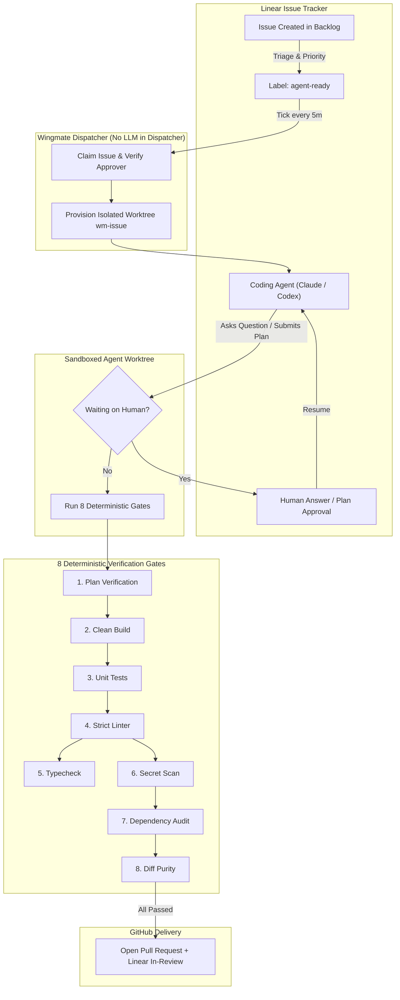

<div align="center">

# 🪽 Wingmate Agents

### **Autonomous Architect Pipeline & Coding Agent Harness for Linear**

[](https://linear.app)
[](https://bun.sh)
[](https://www.typescriptlang.org)
[](#the-8-deterministic-safety-gates)
[](#shipping--distribution)
[](#shipping--distribution)

<p align="center">
  <b>Turn your Linear backlog into verified, production-ready pull requests while you sleep.</b><br>
  Wingmate bridges issue trackers and coding agents running in isolated Git worktrees with deterministic safety gates and human-in-the-loop plan approvals.
</p>

---

### **Pipeline Lifecycle Stages**

| Stage | Badge | Meaning |
| :--- | :--- | :--- |
| **1. Todo** |  | Unassigned candidate issues in Linear awaiting architect prioritization |
| **2. Agent-Ready** |  | Labeled and queued for autonomous pickup by the dispatcher |
| **3. In Worktree** |  | Agent actively implementing code in an isolated sandboxed Git worktree |
| **4. Waiting on You** |  | Paused for human plan review, clarification question, or architecture approval |
| **5. In Review / PR** |  | All 8 gates passed, verified pull request opened on GitHub |
| **6. Done / Merged** |  | PR merged, Linear issue closed, worktree safely reclaimed |

</div>

---

## ⚡ Highlights

- **🔒 Credential-Free Agent Sandboxes**: Agents never hold Git credentials, API keys, or direct push rights. All writes and comments occur via the official Wingmate Linear OAuth app.
- **🛡️ 8 Deterministic Safety Gates**: No PR is ever opened without passing automated plan verification, unit tests, strict typechecking, linter checks, secret scanning, and dependency audits.
- **🙋 Human-in-the-Loop Approval**: When agents formulate an implementation plan or hit ambiguous requirements, execution safely parks and notifies you with 1-click plan approval.
- **🖥️ Architect Console UI**: Zero-dependency, lightweight web dashboard featuring both a 6-stage Kanban board and Funnel pipeline view, Dark & Light color themes, and in-app modal review dialogs.
- **🔌 Multi-Harness Compatibility**: Works out of the box with **Orca ADE**, **Claude Code**, **OpenAI Codex**, or as a standalone CLI daemon for any Git repository.

---

## 🏗️ Architecture



---

## 📦 How to Ship & Distribute Wingmate

Wingmate is designed for zero-friction distribution across different engineering workflows:

### 1. Standalone Single Binary (Recommended)
Built via Bun's native self-contained compilation (`bun build --compile`). Produces a single executable containing the CLI, the server, and the dashboard with **zero external runtime dependencies**:
```sh
# Build binary
bun run build

# Binary output: dist/wingmate (~60MB self-contained executable)
./dist/wingmate --version
```
- **GitHub Releases**: Pre-compiled binaries for `darwin-arm64` (Apple Silicon), `darwin-x64` (Intel Mac), and `linux-x64`.
- **One-Line Curl Installer**:
  ```sh
  curl -fsSL https://raw.githubusercontent.com/furoyce/wingmate-agents/main/install.sh | bash
  ```
- **Homebrew Tap**:
  ```sh
  brew install furoyce/tap/wingmate
  ```

### 2. Orca ADE Plugin & Automation
Wingmate integrates natively into Orca ADE:
- Configures automated scheduled runs via `.orca/automations` running `wingmate tick --precheck` every 5 minutes.
- Integrated Webview tab renders the Wingmate Architect Console (`http://127.0.0.1:4848`).
- One-click worktree opening: clicking **"Open in Orca ↗"** in the dashboard jumps straight into the agent's active session.

### 3. Claude Code & Codex Harness
Run Wingmate alongside agent CLI tools:
- **Claude Code**: Provide `wingmate status` and `wingmate scan` as tools or slash commands within your Claude Code environment.
- **Codex**: Integrate with scheduled cron jobs and continuous PR review loops.

### 4. Background System Daemon
Run the dispatcher and UI server as a background service:
- **macOS (`launchd`)**: Runs automatically at user login.
- **Linux (`systemd`)**: System service for headless CI/CD runner nodes.

---

## 🚀 Quick Start (5 Minutes)

### Step 1: Install Wingmate
```sh
# Clone repository
git clone https://github.com/furoyce/wingmate-agents.git
cd wingmate-agents

# Install dependencies and build
bun install
bun run build
```

### Step 2: Configure Linear & Projects
Create `config/projects.yaml` defining your workspace, projects, and repositories:
```yaml
workspace:
  team: JRF
  approvers: [your-linear-user-id]
labels:
  agent: { supported: [agent-ready, claude, codex] }
projects:
  my-app:
    linearProject: <linear-project-id>
    repos:
      main:
        github: org/my-app
        base: origin/main
        setup: [npm, ci]
        gates: [[npm, test], [npm, run, check]]
```

### Step 3: Run Diagnostics & Enable
```sh
# Verify connectivity, OAuth, and sandboxes
wingmate doctor

# Install worktree and enable the automation
wingmate install --enable
```

### Step 4: Launch the Architect Console
```sh
# Launch the dashboard and open in browser
wingmate ui --open

# Or run the background UI daemon
wingmate ui --serve &
```
Open **[http://127.0.0.1:4848](http://127.0.0.1:4848)** to monitor active worktrees, view metrics, and review agent plans.

---

## 🎨 Architect Console UI

The built-in Web Console gives engineering architects complete visibility into the autonomous agent fleet:


-10B981?style=flat-square)

- **☀️ / 🌙 Dark & Light Themes**: Obsidian slate dark theme and high-contrast light theme with instant switching and `localStorage` persistence.
- **☷ 6-Column Kanban Board**: Fluid, full-width responsive layout automatically adapting to any screen size (ultra-wide monitors, laptops, and split panes) with **zero horizontal sliders**.
- **⚡ 1-Click Plan Approval**: Immediate in-app approvals and custom review modals that resume blocked agent worktrees without leaving the dashboard.
- **🔄 Smart Adaptive Polling**: 3s active tab polling, 10s background polling, and action-driven instant updates. Completely avoids Chromium's 6-socket per-origin bottleneck.

---

## 🛡️ The 8 Deterministic Safety Gates

Every worktree must satisfy all 8 gates before a pull request can be created:

| Gate | Badge | Description | Enforced By |
| :--- | :--- | :--- | :--- |
| **1. Plan** |  | Structured plan written, verified by cross-agent critique or approved by human | Sub-agent Reviewer |
| **2. Build** |  | Project builds cleanly with no compile warnings or errors | Native Toolchain |
| **3. Unit Tests** |  | 100% of test suite passes; regressions automatically trigger retry loop | Test Runner |
| **4. Linter** |  | Strict code formatting and static analysis rules enforced | Biome / ESLint |
| **5. Typecheck** |  | Zero TypeScript or compiler type errors allowed | `tsc --noEmit` |
| **6. Secret Scan** |  | High-entropy scan prevents leaking API keys, private tokens, or credentials | AST Detector |
| **7. Dependency Audit** |  | Prohibits adding unreviewed lockfile dependencies without explicit `allow-deps` | Manifest Guard |
| **8. Diff Purity** |  | Rejects unexpected file modifications outside designated project paths | Path Filter |

---

## 💻 CLI Command Reference

```sh
# --- UI & Dashboard ---
wingmate ui [--port 4848] [--open [browser|orca]] [--serve]

# --- Real-Time Monitoring ---
wingmate status                               # View active worktrees, token usage, cost, and gate status
wingmate status --json                        # Machine-readable snapshot for automations
wingmate status --project <key>               # Filter by project

# --- Dispatcher Automation ---
wingmate tick --precheck                      # Run one dispatch tick with pre-flight checks
wingmate tick --dry-run                       # Inspect eligible issues without claiming them

# --- Safety & Controls ---
wingmate pause [--scope <project|global>]     # Temporarily pause dispatcher claiming
wingmate resume [--scope <project|global>]    # Resume dispatcher claiming
wingmate stop --issue <ID>                    # Emergency stop: kill agent process & worktree immediately
wingmate stop --all --reason "Maintenance"    # Global kill switch

# --- Maintenance & Verification ---
wingmate doctor [--quick]                     # Comprehensive diagnostic suite (Linear, Orca, Sandboxes)
wingmate scan --diff                          # Inspect staged changes for security & policy violations
```

---

## 🔒 Security & Privacy Guarantees

- **No Agent Git Push Rights**: Agents do not have credentials to push to remote GitHub repositories. Wingmate's host dispatcher publishes the branch only after all gates pass.
- **Isolated Network Allowlist**: Agent sandboxes can only access permitted package registries (`registry.npmjs.org`). Direct outbound internet access and GitHub API access are blocked.
- **Auditability**: Every agent session records full terminal logs, token counts, and USD cost tracking in `.wingmate/records/`.

---

## 📚 Documentation

- [📖 Operations Runbook](docs/runbook.md): Daily operational routines, answering questions, handling incidents, and cost optimization.
- [🔑 Linear App Setup](docs/linear-app-setup.md): One-time OAuth application setup, label provisioning, and saved views.
- [🛠️ Runtime Toolchains](docs/runtime-toolchains.md): Pinning Node, Bun, and Python environments per repository without polluting global tools.
- [📐 Design Specification](docs/superpowers/specs/2026-10-05-wingmate-agents-design.md): Deep architectural specification.

---

## 🛠️ Contributing & Development

```sh
# Run TypeScript typecheck
bun run check

# Run Biome linter & formatter
bun run lint

# Run all 900+ unit and simulation tests
bun test

# Compile standalone binary
bun run build
```

---

<div align="center">
  <sub>Built with 🪽 by the Wingmate Team · Powered by Bun & TypeScript</sub>
</div>
