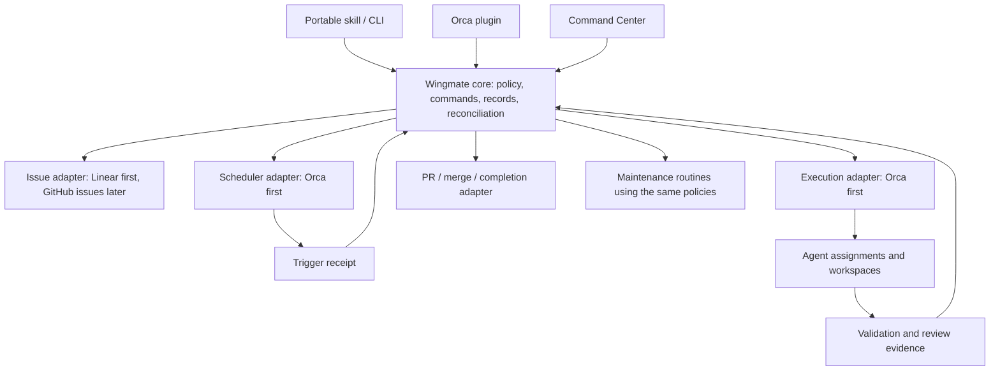

# Wingmate automation management and lifecycle alignment

Status: reviewed design proposal; implementation increments below are not runtime capabilities.
Date: 2026-10-09.
Baseline: remote `main` at `df9a0d9983dde71128ff89228c794eaba8cab730` (PR #26).

## 1. Product direction and decision boundary

Wingmate manages a project's issue-to-delivery lifecycle, scheduled maintenance, and the relationships between routines, runs, agents, workspaces, evidence, and pull requests. The portable skill, CLI, Orca plugin, and Command Center are entrypoints to the same core. Orca is the first execution and scheduling backend. A host that can read the skill does not thereby gain a managed execution or scheduling adapter.

The owner confirmed this direction and requested a design and code review against work already completed. This document proposes the contracts and implementation sequence. It does not activate routines, change existing project approvals, authorize application merges/deployments, or declare additional providers operational.

This extends the [original specification](2026-10-05-wingmate-agents-design.md), particularly architecture, records, Console, and future routine support. Existing record transitions, protected dispatcher actions, gates, stop behavior, and project policies remain authoritative until an increment explicitly migrates them. The [alignment review](../review/2026-10-09-control-layer-alignment.md) distinguishes defects from future features.

## 2. Reuse the implementation already present

| Concern | Existing code at the baseline | Extension required |
| --- | --- | --- |
| Issue workflow | `src/state/records.ts`, `src/machine/states.ts`, `src/machine/advance.ts` | Project-neutral identities and separate delivery/retention projections; retain current pipeline |
| Trigger and reconciliation | `src/machine/tick.ts`, `src/ops/install.ts` | Durable routine registry, occurrences, scheduler bindings, observed state |
| Dispatch and evidence | `src/machine/roles.ts`, `src/state/roles.ts`, `src/native/`, gate receipts | Adapter contracts, explicit run/assignment/workspace ownership |
| Publication | `src/machine/publish.ts`, `src/state/journal.ts` | Separate policy-controlled merge and delivery reconciliation |
| User interaction | Authenticated Linear questions, pause/stop, Console actions | Shared typed operation contracts for every entrypoint |
| Dashboard | `src/server/{types,snapshot,html,actions}.ts` | Automation inventory, run lineage, observed liveness, retained workspace visibility |
| Onboarding/package | `src/ops/onboard.ts`, `src/package/` | Planned configuration changes and routine synchronization |
| Maintenance | Dispatcher watchdog and tracked cleanup | Safe shared cleanup planner; due health/dependency audits |

The native Orca plugin in the separate `wingmate-portable-package` worktree is uncommitted at review time. Its CLI wrapper and dashboard launch approach fits this design, but it is not part of this baseline. The cleanup CLI in `orca-linear-wingmate-agents` is also uncommitted and has confirmed defects; do not import it unchanged.

## 3. Responsibilities and architecture



The core owns admission, transitions, operation IDs, evidence acceptance, ownership, budgets, and reconciliation. Adapters translate external identities and operations; they do not invent a second workflow or bypass policy. UI and plugin mutations call the same core operation as the CLI and receive the same structured result.

Scheduling and agent execution are independent capabilities. A scheduler wakes the core; it need not launch an LLM. Preserve the current deterministic Orca precheck tick and its intentional nonzero exit convention. A platform without schedule discovery can still expose manual execution; unsupported capability is explicit.

Keep deployment local for this first release, with one authoritative state root and dispatcher. Multi-user cloud service, distributed writers, remote plugin transport, and a hosted dashboard are separate extensions. No Vercel deployment is required for this architecture.

## 4. Shared records and identity

These are logical contracts, not a requirement to split every object into a separate database table immediately. Versioned filesystem records and existing locks/journal remain the initial storage model.

| Object | Identity, associations, and required facts |
| --- | --- |
| Project | Stable internal ID/key; repositories; issue-source bindings; execution hosts; validation, capacity, approval, delivery and retention policy revision |
| WorkItem | Internal ID plus `{source, installation/workspace, externalId}`; human display key and source URL; project; routing; workflow cycles |
| AutomationDefinition | Stable ID, project/global scope, kind, trigger/timezone, desired enablement, owner, policy revision, concurrency/misfire behavior |
| SchedulerBinding | Physical wake-up identity: backend, account/host, external schedule ID; `managed` or `observed`; observed enablement/cadence, freshness and drift; explicit many-to-one references from logical definitions |
| TriggerReceipt | Schedule occurrence/event/manual request ID, binding, received/due timestamps and deduplication result |
| AutomationRun | One accepted occurrence; queued/running/succeeded/failed/cancelled/unknown; child operations and work-item cycles; outcome evidence |
| WorkflowRun | A work-item cycle; retries/attempts; current pipeline; trigger/run provenance when known; head and plan revisions |
| AgentAssignment | Workflow or maintenance run; role/provider/model; exact host session/task handle; workspace IDs; attempt; recorded state and separate observed liveness |
| WorkspaceLease | Core-owned workspace ID; host and repository identity; backend worktree ID/path; generation; one mutating owner run and explicit read/retention references; parent/child relation; lifecycle and release receipts |
| Evidence | Producer, run/attempt, gate, head SHA, plan hash where applicable, report digest/path and verdict; evidence class: automated, human acceptance, unavailable |
| Decision | Authenticated actor or explicit project policy; action scope; issue/run/head/plan/policy revision; decision, timestamp and invalidation conditions |
| Delivery | PR identities per repository; reviewed head; required checks; review/approval state; merge receipt; issue synchronization state |
| CleanupOperation | Workspace lease/generation, immutable planned targets and reasons, policy revision, evidence freshness, steps and observed receipts |

A trigger can reconcile many existing work items or start none; a workflow can span many ticks. A dispatcher AutomationRun finishes when its bounded reconciliation completes, even when linked WorkflowRuns are still active. Per-routine overlap admission must not block later recovery ticks for those workflows. A maintenance audit may instead remain running until its own bounded audit work settles. Therefore a tick is not an issue run and a routine is not an agent. Maintenance runs need not create artificial issues; actionable findings may produce linked issues under project policy.

A workspace has one mutating owner generation. Additional references allow readers or retention dependents; they do not grant independent writing or deletion rights. Ownership transfer requires revoking/reconciling the old owner before activating the new generation. Cleanup checks all live assignments and retention references, including explicitly linked children.

Use stable opaque IDs internally. Linear display identifiers and GitHub issue numbers can collide across installations; they must not be global record keys. Do not infer ownership from `wm-*`, a path, a window title, a provider name, or a matching issue string. A user-owned or external workspace can be observed without granting Wingmate deletion rights.

## 5. Lifecycle and completion contract

Preserve the existing two-axis model: `stage` describes operational status; `pipelineStage` describes the development phase. Do not replace it with one long enum. The current pipeline is `intake → plan → planVerify → implement → validate → ui → security → pr`.

| User-visible phase | Existing representation / next contract |
| --- | --- |
| Queue / claim | Eligibility and exclusive record claim; keep concurrency and routing checks |
| Plan / review plan | Existing `plan`, `planVerify` and reviewer evidence; add a dispatcher-enforced owner decision bound to scope/plan where policy requires one |
| Implement | `implement`; multiple role assignments may run within the same cycle |
| Validate | `validate`, `ui`, `security`; pinned commands, applicable UI proof and review evidence |
| PR ready | `pr` followed by operational `review`; exact-head publication guards remain required |
| Approve / merge | New delivery operation, or externally observed owner merge; never inferred from a passing test or a closed PR |
| Complete | Verify configured delivery boundary, record its evidence, synchronize the issue idempotently |
| Cleanup | Independent retention operation after completion/cancellation policy and ownership checks; its failure leaves delivery truth intact |

The default `done: review` remains a handoff boundary: work stays review-ready/in source review, not merged or source Done, until an authorized later transition. Existing `done: merge`/`deploy` schema values do not establish implemented automatic merge/deploy behavior. Show unsupported automation explicitly until an adapter and policy implement it. Externally closing an issue records the source state but does not prove its code shipped. Multi-PR delivery requires every configured required PR, across the required repositories, to satisfy its delivery policy; an optional/unrelated merged PR cannot complete the issue.

Today `ask-first` instructs the coordinator to ask, and eligible Linear replies are authenticated when a question exists. The dispatcher does not independently require a scope/plan-bound owner decision before implementation. Add that prerequisite for managed admission/progression and publication, distinguish accepted scope from later changed plans, and invalidate decisions only when their bound inputs change. A writable coordinator can still edit files before approval; preventing those edits requires execution capabilities that enforce read-only planning followed by a separately authorized writable launch. The current pilot's trust limitations must remain explicit until that capability exists.

For merge-enabled projects, require the configured approval source, permitted branch/repository, fresh required checks and reviews for the exact PR head, and accepted policy revision. Revalidate before the merge side effect; changed head invalidates previous approval/evidence as applicable. Record actual merged head/base/merge commit. A GitHub self-approval failure is not a successful formal review. Human direction and repository review requirements are separate evidence.

Issue-source event authorization must identify the actual configured actor and permitted event purpose. The current `botActorType === "integration"` check is too broad: it authorizes unrelated integration state changes. A trusted GitHub completion signal must be limited to verified delivery completion for the linked PRs; it must not authorize plan decisions, lifecycle-label changes or review resumption. An authorized human source close remains a source-close action, independently of verified merge delivery.

After a verified merge, completion synchronization may retry without re-merging. Retention failures display `delivery complete / cleanup blocked`, not a failed development run. Closed-unmerged PRs, abandoned runs and cancelled issues follow an explicit cancellation/retention policy; they never masquerade as successful merge delivery.

Pause, await-human, blocked, and released remain distinct. Releasing ownership is not completing an issue. Stale observation is not proof an agent exited. A stopped or superseded run cannot resume under an expired ownership generation.

## 6. Scheduling, inventory and reconciliation

Support three inventory classes: Wingmate-managed, externally managed/observed, and unsupported/unreachable. Show provider/host, external ID, observed time, cadence, next due time if known, recent runs, owning project, and drift. Unknown remains unknown.

Adopting an external routine requires an explicit operation that captures the existing definition and binds ownership. Discovery must not edit schedules. Schedule migration disables the verified old binding before enabling its replacement; reconcile ambiguous outcomes before retrying. Never install duplicate dispatchers because the plugin and skill both initiated onboarding.

Initial scheduling remains **one shared Orca wake-up every five minutes**. New project maintenance definitions become logical due routines evaluated by that reconciler. Many logical definitions reference the same physical SchedulerBinding. Disabling one project routine changes its admission only; it must not disable/delete the shared wake-up. Disabling a routine prevents new occurrences, while stop/cancel are distinct operations for active work. Project/global pauses remain explicit overriding policies. Do not install four independent mutating timers per project. Additional native schedule bindings can follow when capability and ownership contracts pass conformance tests.

Every occurrence has a durable deduplication key derived from definition ID and due instant (UTC; retain IANA timezone), with the selected definition revision recorded on its receipt. Persist an effective-from instant and admission watermark when revisions change. A schedule edit, adoption or binding migration cannot recreate an occurrence already admitted; define the cutover before enabling the new binding and reconcile any ambiguous old receipt first. Events use external delivery identity; manual requests use client operation IDs. Admission persists the receipt before dispatch. Repeated wake-ups can reconcile the same occurrence without launching another worker.

Default overlap policy is forbid concurrent runs of the same routine/project, with bounded queue/coalescing. After downtime, reconciliation runs first; coalesce missed maintenance intervals rather than replaying an unbounded backlog. Define cron/timezone/DST handling through a tested library and persist the computed due instant. Existing issue work is recovered before new claims, subject to actual capacity and stop/pause policy.

Retain the existing local tick lock and record guards. Add operation/ownership generations to external effects. A crash after launch but before receipt persistence must become `launch outcome unknown`; query/adopt by operation ID where supported, otherwise park for reconciliation. Do not promise exactly-once delivery from providers that cannot prove it. File locks are not a distributed locking strategy.

## 7. Adapter contracts

| Adapter | Required operations and evidence |
| --- | --- |
| Scheduler | Discover/observe; plan/apply managed definition; enable/disable; run history; capability/freshness report; stable external IDs |
| Execution | Discover capabilities; launch with operation ID; observe; deliver/resume; request cancellation; prove termination/release; collect artifacts |
| Workspace | Create/adopt only with explicit ownership; inspect trusted repository and dirty/unmerged state; enumerate owned descendants; remove with receipts |
| Issue source | List eligible work with cursor and completeness; read issue/comments; authenticate decisions; journal state/comment/link writes |
| Delivery | Read PR head/checks/reviews; publish; merge only under policy; verify merge outcome; optional deploy as a later distinct capability |

Each adapter returns structured errors, observation timestamps, completeness, host identity and capability versions. Read failures must not become empty successful inventories. Cancellation acceptance is not termination evidence. Credentials stay in the operator/adapter boundary; neither packages nor UI responses contain secrets.

Provider admission remains role-specific. Reuse current Claude/Codex coordinator and protected role paths through Orca. Configuration lists for Cursor/Antigravity or a portable skill readable by Grok, Pi, OpenCode or Gemini do not prove those execution paths satisfy isolation, launch, liveness and cancellation requirements. Add providers only through conformance tests on their actual supported interface; do not silently substitute providers.

## 8. Onboarding and maintenance

Extend the existing read-only `wingmate onboard --project KEY` planner before adding an apply path. A future apply command must consume a plan hash and configuration revision, report every intended repository setting, issue-source/view change, routine definition and scheduler binding, then reconcile outcomes. Enabling routines is a distinct operation with existing readiness requirements and project authorization.

Plans may supply starter maintenance definitions, but must identify prerequisites and unsupported capabilities. Reject unknown new maintenance keys instead of silently stripping them. Keep older valid project configurations readable through a documented version migration. Syntax below is conceptual; it must not be pasted into the current schema:

```yaml
# Future versioned configuration; NOT supported by current main.
maintenance:
  worktreeSweeper:
    enabled: false
    cadence: "*/30 * * * *"
    afterVerifiedMerge: true
  staleAgentWatchdog:
    enabled: false
    idleAfterMinutes: 60
    action: reconcile-and-park
  repoAudit:
    enabled: false
    cadence: "0 9 * * 1-5"
    executionProfile: maintenance-audit
  depsAudit:
    enabled: false
    cadence: "0 3 * * 1"
    remediation: report
```

| Routine | Initial behavior | Boundaries |
| --- | --- | --- |
| Worktree sweep | Plan/removal of demonstrably owned, eligible workspaces; preserve history | Never delete by name; unknown ownership/liveness/PR state blocks removal |
| Stale-agent watchdog | Observe, bounded nudge/recovery, then park/escalate | No idle-only process killing; reuse existing question/review waits and recovery caps |
| Repository health | Pinned checks on an immutable main SHA in an owned audit workspace | Do not execute repo code in the operator process or modify the user's main checkout |
| Dependency/security audit | Project-approved lockfile/advisory checks; deduplicated evidence/findings | Remediation is a new policy-controlled issue/PR workflow, never arbitrary lockfile pruning or automatic upgrades |

Maintenance can have its own budget and reserved capacity, but it still consumes global host/provider resources. Choosing Codex or a cheaper model does not exempt a job from concurrency, quota, isolation, or accounting. Provider/model selection is an execution profile resolved against actual availability.

## 9. One safe cleanup operation for CLI, ticks and UI

Use a shared planner plus a journaled executor. Dry run invokes the planner and exposes identical eligibility/rejection reasons without mutating records or acquiring write credentials. Execution rechecks ownership, live state and plan freshness before side effects.

Required sequence:

1. Resolve issue/project scope to exact configured repositories and owned workspace leases, including explicitly owned children.
2. Read complete, fresh host inventory, record state, required PR states, Git dirty/unmerged state and active assignments. Unavailable or truncated evidence defers deletion.
3. Verify terminal lifecycle, grace policy, branch retention and outstanding work. A grace override bypasses only time, never lifecycle, open PR, ownership or preservation checks.
4. Persist operation intent and immutable target IDs/generations. Request stop of owned sessions, confirm termination, and reconcile owned descendants and background processes on their exact host.
5. Remove only approved workspace targets. A stop/sweep failure defers removal. Never use a path/name match to kill a process.
6. Confirm absence from a successful authoritative observation; write removal receipts and release leases. Retain workspace identity, branch, run lineage and evidence in history after filesystem removal.

`afterVerifiedMerge` means eligibility at the next successful reconciliation after observing a matching actual merge; it is not a guarantee of instantaneous deletion. All other safety predicates still apply. Orphans mean owned leases without live owners, not all `wm-*` worktrees. Unregistered candidates are inventory findings until ownership is explicitly resolved.

## 10. Command Center and plugin contract

The dashboard should answer: what is scheduled, what ran, which issue it concerns, who is working where, what evidence exists, what is waiting, and what resources remain after delivery.

- Portfolio: project work, incident/maintenance findings, queue, capacity and items awaiting decisions.
- Automations: managed and observed routines, backend, desired versus observed enablement, cadence/next due, drift and last observation.
- Issue/run detail: pipeline, attempts, agent roles, exact workspaces, head/plan revisions, gates, PRs and decisions.
- Workspaces: active, parked, released/retained, cleanup-pending and removed history; owned parent/child lineage and scope.
- Maintenance: due/running/completed audits and cleanup plans, retention reasons and retry results.

Counts distinguish assigned agents from observed running processes and queued tasks. Browser/native test jobs are execution tasks, not extra agents. Historical records do not prove current liveness. A recent manual tick does not prove that a scheduler is enabled. A project view may show a shared routine binding, but portfolio totals must not count it once per project.

Expose typed commands and read models from core modules before introducing another network service. Additive versioned API fields let the existing Console consume new records without changing their authority. Mutations carry operation ID, selected scope and expected revision; responses include accepted/acted/confirmed/unknown status and audit links.

Add and test the Console request boundary before expanding management actions: permitted loopback Host/origin, authenticated local session, CSRF protection, strict JSON/method validation, scoped target validation and core operation auditing. The current server does not enforce that boundary: snapshot/SSE use wildcard CORS and a foreign-Origin text/plain POST can execute the pause handler. Binding to loopback alone is insufficient. Preserve the current fail-closed answer endpoint until an authenticated decision path exists; a generic UI session must not impersonate a Linear approver. Define a local plugin/browser bootstrap that establishes its session without exporting long-lived credentials or placing bearer secrets in URLs. Existing promote/pause/open handlers also need conversion to scoped core operations; do not advertise them as already uniformly journaled.

The native plugin owns host menus, notifications and launch surfaces; it must not own a separate scheduler, records directory or approval system. The portable skill explains these same commands. Loading either surface does not install or activate routine execution. Native panel rendering depends on an actual supported host bridge; the existing dashboard remains usable in the browser.

## 11. Migration and independently deliverable increments

Use new numbered increments here, not a retroactive renaming of already accepted slice 1 or slice 2.

| Increment | Implementation scope | Acceptance |
| --- | --- | --- |
| A0: existing control boundaries | Console request/session/action boundary; exact issue-event authorization; accurate pause/health/delivery labels; enforced scope decisions for managed progression | Foreign-origin reads/actions rejected; legitimate same-origin operations remain usable; unrelated integrations cannot complete/resume work; released is not shipped; missing/stale approval cannot authorize implementation/publication |
| A: cleanup correctness | Repair local prototype; share eligibility/planner across tick/CLI; exact ownership and termination receipts | All confirmed review repros fail safely; dry-run parity; scoped children; dirty/open-PR/unverifiable cases; replay after partial deletion |
| B: registry and identity | Definition/binding/occurrence records; versioned IDs/read models; wrap current Orca installation | Existing installations migrate without duplicate schedules; missing provenance remains unknown; colliding external issue IDs stay distinct |
| C: lifecycle visibility | Run/assignment/workspace/delivery projections in Console and thin plugin | Count integrity, retained/released workspace visibility, source/head provenance and identical scoped operation results through all entrypoints |
| D: onboarding and core maintenance | Plan/apply/sync; logical due routines on existing dispatcher; watchdog and audit profiles | Idempotent apply; changed-plan refusal; unknown-key errors; downtime/overlap tests; global capacity and stop rules apply |
| E: issue and delivery adapters | GitHub issue intake; policy-controlled merge/completion; cancellation retention | Exact-head merge races, rejected review, externally merged PR, completion retry and closed-unmerged tests; current review-only projects unchanged |
| F: additional hosts | Observed routine import first, managed scheduling/execution by adapter capability | Shared conformance suite; explicit adoption; no duplicate dispatch; launch/cancel uncertainty preserved; provider isolation evidence |

Before writing new-format records: snapshot existing state, test read-only migration against fixtures, introduce a schema-aware reader, and provide a reversible migration receipt. One authoritative writer owns each record type. Derive legacy run/assignment projections deterministically; never fabricate scheduler provenance. Legacy records without ownership leases are retained until verified adoption. An older binary must refuse a newer write format instead of silently stripping fields. Rollback disables incompatible writers and restores the matching binary/state schema; do not simply launch an old binary on new data.

Increment dependencies: A0 and A can be implemented independently before broadening unattended management; B precedes general scheduler management; C follows B's contracts but can fix current display defects independently; D uses A/B; E uses B and delivery policy; F builds on B and conformance coverage. The in-progress plugin can ship as a truthful thin surface without waiting for all future adapters, after the inherited Console boundary is addressed for management use.

## 12. Review and validation requirements

Keep current tests and invariants; do not replace the proven state machine during abstraction work. Add scenario tests where they protect actual effects: duplicate trigger delivery, schedule edits/adoption/binding migration at a due instant, clock/DST/missed runs, partial inventories, crash-after-launch, stop acknowledgement loss, stale head approvals, cleanup after partial removal, and cross-project ownership. Include shared-binding enablement, completed tick versus active workflow overlap, ownership transfer with readers, and required multi-PR delivery. Use fakes and isolated temporary roots for destructive cases.

Adapter conformance validates launch identity, freshness, idempotency, cancellation, artifact provenance, unavailable capabilities and failures. UI tests validate counts and scope rather than only copied labels. Migration tests cover multiple cycles, archived records, released workspaces, malformed entries and old-reader refusal. Read-only import tests must prove they do not enable, modify or delete external routines.

The immediate deliverable is this aligned design and its code-review evidence. Runtime implementation, activation and provider readiness must be reported independently; passing unit tests does not prove a host's installation or live permissions.
